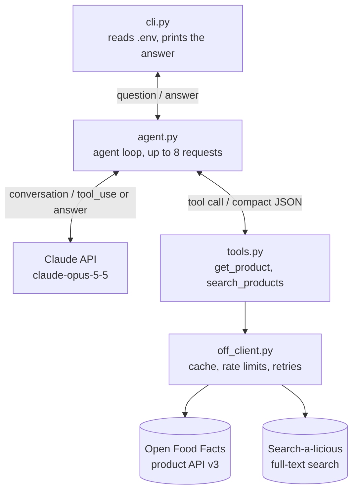

# food-facts-agent

[](https://github.com/KonradJKl/food-facts-agent/actions/workflows/ci.yml)

A command line agent that answers questions about food products, such as "Which of these mueslis has the least sugar per 100 g?" or "Enthält Nutella Palmöl?". It looks the products up in [Open Food Facts](https://world.openfoodfacts.org) through tool calls of the Claude API and answers only with the data it retrieved.

## What it does

- Looks up products by barcode, or searches by name, brand or product type. Searches are limited to products sold in Germany unless the model asks for a worldwide search.
- Answers in German or English, in the language of the question.
- Takes nutrition values, ingredients, allergens, labels and the Nutri-Score only from Open Food Facts and cites every product as `Name (Barcode <digits>)`.
- Says when Open Food Facts has no value instead of estimating one. An empty allergen list or an "unknown" palm oil tag is not read as "free of".
- Answers one question per call; there is no conversation.

## Example session

Both answers are copied from the evaluation run on 2026-10-19 ([eval/results.json](eval/results.json)). The CLI prints the same text.

A comparison of three products given by barcode. The agent requested all three products in one step:

```console
$ food-facts "Which of these three mueslis has the least sugar per 100 g: 4260188784710, 4251680805683 or 4058172307188?"
```

> Strawberry Cassis (wenig Zucker) (Barcode 4251680805683) by My Muesli has the least sugar of the three.
>
> Ranked from least to most sugar:
> - Strawberry Cassis (wenig Zucker) (Barcode 4251680805683): 4.1 g sugars per 100 g
> - My muesli (Barcode 4260188784710): 12.6 g sugars per 100 g
> - Früchte Müsli (Barcode 4058172307188), dmBio: 32 g sugars per 100 g
>
> These numbers are total sugars, which includes sugar that comes naturally from fruit. They don't show how much sugar was added. The Früchte Müsli is a good example. It carries a "no added sugar" label, but its ingredient list starts with "30% Sultaninen\*" and also includes dried apricots, figs, dates, apple and raisins ("Weinbeeren"). That's probably where most of its sugar comes from. My muesli, on the other hand, lists added sweeteners: "Reissirup", "Honig" and "Apfeldicksaft".
>
> Open Food Facts has no ingredient list for Strawberry Cassis, so I can't tell you where its sugar comes from or which allergens it contains. Please check the package label for that.

A product whose nutrition values are missing in Open Food Facts. The agent looked up the barcode and then searched for another entry of the same product:

```console
$ food-facts "Wie viel Zucker hat das Sylter Müsli mit dem Barcode 4251680801722?"
```

> Den Zuckergehalt kann ich dir leider nicht nennen. Open Food Facts hat für dieses Produkt keinen Wert gespeichert.
>
> Unter dem Barcode ist Sylter Müsli von My Muesli (Barcode 4251680801722) eingetragen. Der Eintrag ist aber fast leer: Es fehlen alle Nährwerte, also auch Zucker, Energie und Fett, die Zutatenliste und ein Nutri-Score. Es gibt dort also auch keine Angabe zu zugesetztem Zucker.
>
> Ich habe außerdem nach "mymuesli Sylter Müsli" gesucht. Von 1723 Treffern hat die Suche 20 angezeigt. Darunter war kein weiterer Eintrag für das Sylter Müsli, nur derselbe leere Eintrag.
>
> Den Zuckergehalt findest du in der Nährwerttabelle auf der Packung. Wenn du magst, kannst du die Werte bei Open Food Facts ergänzen: https://world.openfoodfacts.org/product/4251680801722

With `-v` the CLI also logs every step and tool call to stderr. These lines are from an earlier run of "Enthält Nutella Palmöl?": a search, then two product lookups in one step, then the answer. `cache read` and `cache write` count the input tokens read from or written to Claude's prompt cache; `input tokens` counts only the uncached rest, which is why it stays in single digits.

```text
INFO food_facts_agent.agent: Step 1: tool_use, input tokens 4, cache read 0, cache write 1903, output tokens 50
INFO food_facts_agent.agent: Tool search_products {"query": "Nutella"} -> ok, 6097 characters
INFO food_facts_agent.agent: Step 2: tool_use, input tokens 2, cache read 1903, cache write 3435, output tokens 127
INFO food_facts_agent.agent: Tool get_product {"barcode": "4008400401621"} -> ok, 1021 characters
INFO food_facts_agent.agent: Tool get_product {"barcode": "40084053"} -> ok, 743 characters
INFO food_facts_agent.agent: Step 3: end_turn, input tokens 2, cache read 5338, cache write 1113, output tokens 608
```

## Setup and usage

You need Python 3.12, an Anthropic API key and an email address for the Open Food Facts User-Agent.

```bash
git clone https://github.com/KonradJKl/food-facts-agent.git
cd food-facts-agent
python -m venv .venv
```

Activate the environment (`.venv\Scripts\Activate.ps1` in PowerShell, `source .venv/bin/activate` on Linux and macOS), then install the package with the development tools:

```bash
pip install -e ".[dev]"
```

The editable install (`-e`) is required: the CLI finds `prompts/system.md`, `.env` and the cache folder through the source folder.

Copy `.env.example` to `.env` and fill in:

- `ANTHROPIC_API_KEY`: your API key. It is only read from `.env` or the environment and never logged.
- `ANTHROPIC_MODEL`: `claude-opus-5-5`.
- `OFF_CONTACT_EMAIL`: sent in the User-Agent `FoodFactsAgent/0.1 (<email>)`, as Open Food Facts asks of API users.

Then ask a question:

```bash
food-facts "Enthält Nutella Palmöl?"
food-facts -v "Does the muesli with barcode 4260188784710 contain palm oil?"
```

The exit code is 0 for a complete answer, 1 for an incomplete answer (token limit, step limit or a declined request) or a Claude API error, and 2 for a missing setting or an `OFF_CONTACT_EMAIL` without an @ sign. A wrong API key or model ID is only noticed by the Claude API and gives 1.

## Architecture



| File | Role |
|---|---|
| [src/food_facts_agent/cli.py](src/food_facts_agent/cli.py) | The `food-facts` command: reads the settings, runs the agent, prints the answer and sets the exit code. |
| [src/food_facts_agent/agent.py](src/food_facts_agent/agent.py) | The agent loop: sends the conversation to Claude, runs the requested tools, sends their results back and stops at a final answer or after 8 requests. |
| [src/food_facts_agent/tools.py](src/food_facts_agent/tools.py) | The two tool schemas and their implementations, which turn Open Food Facts data into compact JSON. |
| [src/food_facts_agent/off_client.py](src/food_facts_agent/off_client.py) | The HTTP client for Open Food Facts. |
| [prompts/system.md](prompts/system.md) | The system prompt. |
| [eval/](eval/) | Evaluation questions, checks, runner and saved results. |

The main design decisions:

- **A hand-written agent loop instead of the SDK's tool runner.** The loop is short, it is the part of the project worth testing, and the tool runner is a beta helper that would hide it.
- **Strict tool schemas.** `claude-opus-5-5` does not accept forced tool calls, so `strict: true` guarantees schema-valid arguments instead. The barcode has no regex: in strict mode the model could only "repair" a wrong barcode by changing digits. Instead the client rejects it and the model reports the problem.
- **Product API v3 with the classic `nutriments` fields.** `/api/v3/product` returns per-100-g fields in the same shape as the search results. The newer v3.6 structure records the source of each value, including estimates; switching to it is a possible upgrade.
- **Search-a-licious for search.** Questions like "Does product X contain palm oil?" need a search by name and brand, which the structured v2 search does not offer. The query is built in code from plain words and tag filters, so the model never writes Lucene syntax.
- **Compact tool results.** A search result contains only barcode, name, brand, quantity, Nutri-Score and 8 nutrition values per 100 g, with the unit in the key (`sugars_g`) and `null` for missing values. A product from `get_product` adds serving size, NOVA group, ingredients, allergens, traces, the Open Food Facts ingredient analysis (palm oil, vegan and vegetarian status), labels, countries and a link to its page; the model calls it for details.
- **A careful API client.** Every request sends the User-Agent and has a timeout. Responses are cached in `.cache/off/` (products for 7 days, searches for 24 hours, unknown barcodes too). A sliding window keeps to the limits of 15 product reads and 10 searches per minute. After a rate limit error, a server error or a timeout the client tries again, up to 3 attempts in total, with exponential backoff.
- **Claude request settings.** Effort is set to `medium`. A cache breakpoint after the tools and the system prompt lets separate runs share them, and automatic caching covers the growing conversation of one run. `fallbacks="default"` (a beta) lets the API answer with another model when a safety classifier declines a request. The conversation is only ever appended to, as Claude Opus 5.5 requires for the thinking blocks that are sent back.
- **Errors the model can react to.** An unknown barcode, an invalid input or an unavailable Open Food Facts service comes back to the model as a tool result marked `is_error`, so it can explain the problem. Claude API errors end the CLI with a message.

## Prompt design

The system prompt is in [prompts/system.md](prompts/system.md). It is written for `claude-opus-5-5` and follows Anthropic's guidance for that model: plain sentences that give the reason for a rule, goals instead of step-by-step scripts, and no all-caps words, "CRITICAL" markers or threats. The main decisions:

- **Every product fact comes from a tool result.** Nutrition values, ingredients, allergens, labels and the Nutri-Score must appear in a tool result of the same run, even for well-known products. The prompt states this once, with the reason that people act on the answers.
- **Missing is not zero.** A `null` field means Open Food Facts has no value. The model says so instead of estimating and leaves the product out of a ranking on that value. A `0` is a real value.
- **Rules for data quirks found in the recorded API responses.** Nutella's ingredient analysis says its palm oil content is unknown, although "palm oil" is in its ingredient list, so the ingredient list wins. A product without an ingredient list has an empty allergen list, so an empty list does not mean allergen-free. "Das Ungesüßte Beeren-Müsli" has 13 g sugars per 100 g, so the model judges products by their values, not by their names.
- **Comparisons cover only the search results.** A search returns at most 20 products ordered by relevance. The answer says how many products the search returned out of the total number of matches.
- **Answers that a script can check.** Each product is cited by its name as returned, untranslated, followed by `(Barcode <digits>)`, and each number stands next to its nutrient. German answers use a decimal comma, and the number check in the evaluation accepts both separators. Values are rounded only beyond two decimals, and computed values such as differences appear only when the user asks for them.
- **The prompt does not name the tools.** When to call each tool is part of the tool descriptions in [tools.py](src/food_facts_agent/tools.py). The prompt does not tell the model to limit tool calls, because current models follow such limits literally.
- **Plain terminal text.** The CLI prints the answer as it is, so the prompt asks for plain sentences and simple dash lists instead of Markdown.
- **A fixed prompt.** The prompt contains no date or other changing text. It is part of the cached request prefix, and it stays identical across the requests of one run, which Claude Opus 5.5 requires for the thinking blocks that the agent sends back.
- **No request for visible reasoning.** How much the model thinks is set with the `effort` parameter in the code. Asking the model to show its reasoning can make the API decline the request.

## Evaluation

[eval/questions.json](eval/questions.json) holds 15 questions, 11 in German and 4 in English: 6 fact questions, 2 comparisons and 7 traps (an unknown barcode, an invalid barcode, missing nutrition values, a missing ingredient list, a product name that claims "unsweetened", an ambiguous brand name and a question that is not about food). The expected values were looked up in Open Food Facts on 2026-10-19.

[eval/run_eval.py](eval/run_eval.py) asks every question through the agent and checks each answer:

- **Tools:** tools were used for product questions and not for the question about the Eiffel Tower. The question with the invalid barcode accepts answers with or without a tool call.
- **Citation:** every barcode in the answer appears in the question or in a tool result, and at least one is cited when a tool found a product. Some questions expect a specific barcode, such as the winner of a comparison.
- **Numbers:** every number in the answer appears in a tool result, either as a value or inside a text such as an ingredient list, or in the question. The 100 of "per 100 g", the number of products a search returned and general facts a question lists, such as barcode lengths, are also accepted. Values with up to two decimals must match exactly; longer values may be rounded, so 0.1075 may appear as "0,11".
- **Facts:** regular expressions per question, for example "must contain 56,3" or "must not say palmölfrei".
- **Language:** the answer is written in the language of the question, judged by counting common short words.
- **Stop:** the run ended with a final answer.

```bash
python eval/run_eval.py
```

`run_eval.py` does not record token usage, so the cost of the run below was not measured. One question asked with `food-facts --verbose`, which logs the token counts of every step, cost about 5 US cents with `claude-opus-5-5`, so a full run of 15 questions costs roughly 75 cents. `--only ID` runs single questions and prints their answers, `--repeat N` runs every question N times, and `--recheck` evaluates the answers saved in [eval/results.json](eval/results.json) again with the current questions and checks, without API calls.

### Results

`claude-opus-5-5`, effort `medium`, one run per question on 2026-10-19:

| Question | Kind | Passed | Tools | Citation | Numbers | Facts | Language | Stop |
|---|---|---|---|---|---|---|---|---|
| sugar-barcode-de | fact | 1/1 | 1/1 | 1/1 | 3/3 | 1/1 | 1/1 | 1/1 |
| salt-barcode-en | fact | 1/1 | 1/1 | 1/1 | 2/2 | 1/1 | 1/1 | 1/1 |
| palm-oil-de | fact | 1/1 | 1/1 | 1/1 | 7/7 | 1/1 | 1/1 | 1/1 |
| palm-oil-en | fact | 1/1 | 1/1 | 1/1 | 2/2 | 1/1 | 1/1 | 1/1 |
| traces-soy-de | fact | 1/1 | 1/1 | 1/1 | 7/7 | 1/1 | 1/1 | 1/1 |
| compare-three-en | comparison | 1/1 | 1/1 | 1/1 | 7/7 | 1/1 | 1/1 | 1/1 |
| compare-search-de | comparison | 1/1 | 1/1 | 1/1 | 27/27 | 1/1 | 1/1 | 1/1 |
| allergy-de | fact | 1/1 | 1/1 | 1/1 | 4/4 | 1/1 | 1/1 | 1/1 |
| trap-unknown-barcode | trap | 1/1 | 1/1 | 1/1 | 2/2 | 1/1 | 1/1 | 1/1 |
| trap-invalid-barcode | trap | 1/1 | 1/1 | 1/1 | 9/9 | 1/1 | 1/1 | 1/1 |
| trap-missing-values | trap | 1/1 | 1/1 | 1/1 | 2/2 | 1/1 | 1/1 | 1/1 |
| trap-no-ingredients | trap | 1/1 | 1/1 | 1/1 | 1/1 | 1/1 | 1/1 | 1/1 |
| trap-name-claim | trap | 1/1 | 1/1 | 1/1 | 11/11 | 1/1 | 1/1 | 1/1 |
| trap-ambiguous-name | trap | 0/1 | 1/1 | 1/1 | 30/32 | 1/1 | 1/1 | 1/1 |
| trap-not-food-en | trap | 1/1 | 1/1 | 1/1 | 0/0 | 1/1 | 1/1 | 1/1 |

14 of 15 answers passed. The "Numbers" column counts grounded numbers out of all numbers in the answer.

- **trap-ambiguous-name failed for a real reason.** The answer listed 13 mueslis of the brand with their exact sugar values and named the products without values, but its first paragraph says the sugar values lie "zwischen etwa 3 und 28 g". The values are 3.4 and 28.5, and the prompt allows rounding only for values with more than two decimals.
- **trap-invalid-barcode was changed after the first run.** The model did not call a tool: it explained that 1234567 has only 7 digits and that barcodes have 8 to 14, mentioning EAN-8 and EAN-13. That is correct, but the question expected a tool call and treated 8, 13 and 14 as ungrounded numbers. The question now accepts answers with or without a tool call and allows these three numbers. Before this change the run scored 13 of 15; `--recheck` re-evaluated the saved answers.
- **One run is not a pass rate.** Answers vary between runs. `--repeat 3` shows how stable the results are, at three times the cost.

### Limits of the checks

- Numbers are not tied to products. A value of another product in the same tool results counts as grounded, and after a search many numbers are allowed: an invented "20 %" would match the 20 products a search returns.
- For a comparison the checks look at which barcodes the answer cites, not at which product the sentence calls the winner.
- The regular expressions were tested against about 180 example answers written for this purpose, correct and wrong ones. Careful wordings such as "ist nicht als glutenfrei gekennzeichnet" can still fail a check.
- Computed values such as amounts per portion count as ungrounded, so no question asks for them.
- compare-search-de depends on the search query: if the model searches with other words, the expected winner can change.
- Open Food Facts data changes, so expected values can go out of date.

## Development

```bash
pytest
ruff check .
ruff format --check .
```

The 154 tests never call the Claude API or Open Food Facts:

- [tests/fixtures/](tests/fixtures/) holds five Open Food Facts responses recorded on 2026-10-16.
- The client tests use `httpx2.MockTransport` instead of the network, with a fake clock so that retries and rate limits run without waiting.
- The agent tests use a fake Claude client that returns prepared SDK message objects. One test runs the real `anthropic` client against a mocked transport to check the HTTP requests it builds.
- [tests/conftest.py](tests/conftest.py) blocks every real HTTP request, so a test that tries one fails.

[GitHub Actions](.github/workflows/ci.yml) runs the same three commands on every push to `main` and on pull requests, with Python 3.12 on Ubuntu 24.04 and without API keys. The evaluation is not part of CI because it calls the Claude API.

## Limitations

- Open Food Facts is crowd-sourced. Values can be missing, outdated or wrong, and the agent can only report what is there.
- A search returns at most 20 products ordered by relevance, so "the lowest sugar" means the lowest among those 20. Search-a-licious is at API version 0.1 and gives no stability guarantee.
- The values per 100 g are per 100 ml for drinks, although the keys say `_g`.
- The tools expose 8 nutrition values. Energy in kJ, sodium and added sugars are not available, so the agent can only report total sugars.
- For ingredients the tool prefers the German text. In one recorded response that text was a shorter English copy without "lecithins (soya)", so a field can be less complete than another language version.
- One question per call; the agent cannot ask a follow-up question.
- The fixed messages for a declined request and for the step limit are in English, even when the question is in German.
- The rate limiter counts requests within one process. Many runs in quick succession rely on the cache to stay within the limits.
- The agent uses features of `claude-opus-5-5`, among them the beta `fallbacks` parameter and the `effort` setting. Other models may need changes in [agent.py](src/food_facts_agent/agent.py).
- The cost of about 5 US cents per question comes from a single measured question.

## Data and license

The code is under the [MIT license](LICENSE).

Product data comes from [Open Food Facts](https://world.openfoodfacts.org). The database is available under the [Open Database License](https://opendatacommons.org/licenses/odbl/1-0/), its individual contents under the [Database Contents License](https://opendatacommons.org/licenses/dbcl/1-0/), and product images under [CC BY-SA 3.0](https://creativecommons.org/licenses/by-sa/3.0/); this project does not use images. [tests/fixtures/](tests/fixtures/) and [eval/results.json](eval/results.json) contain small extracts of Open Food Facts data under these licenses. The repository contains no database dumps.
